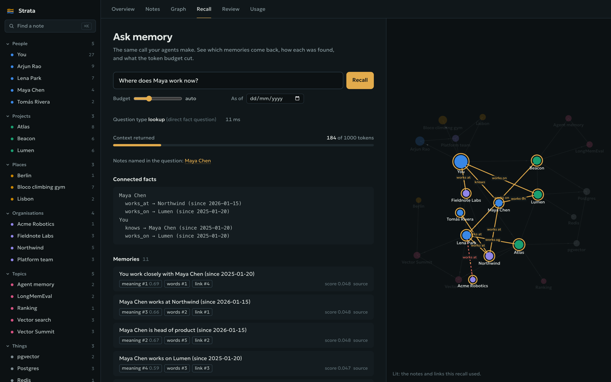
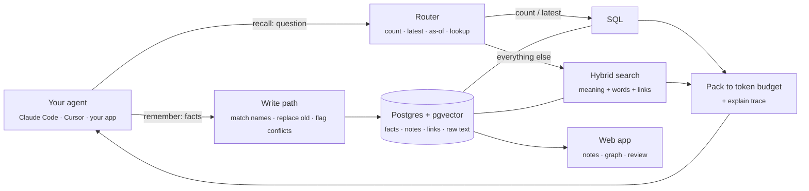
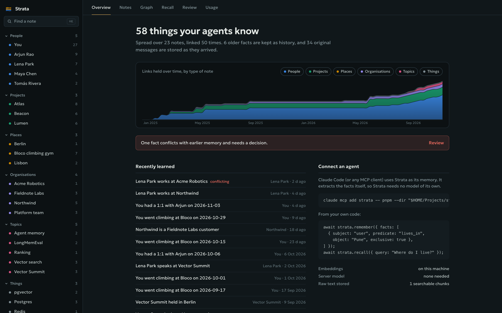
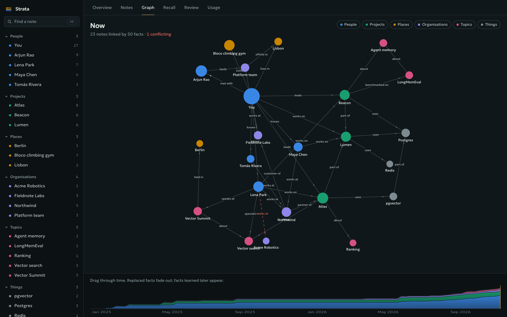
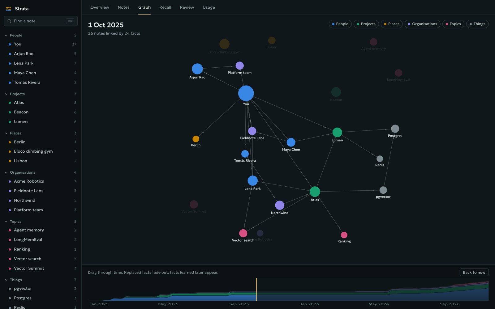
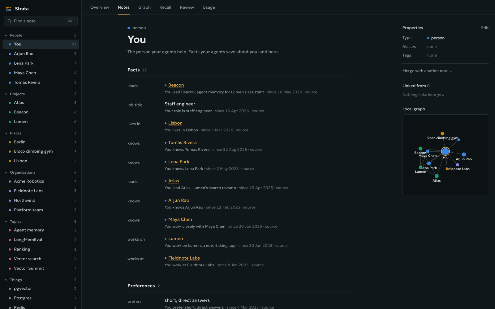
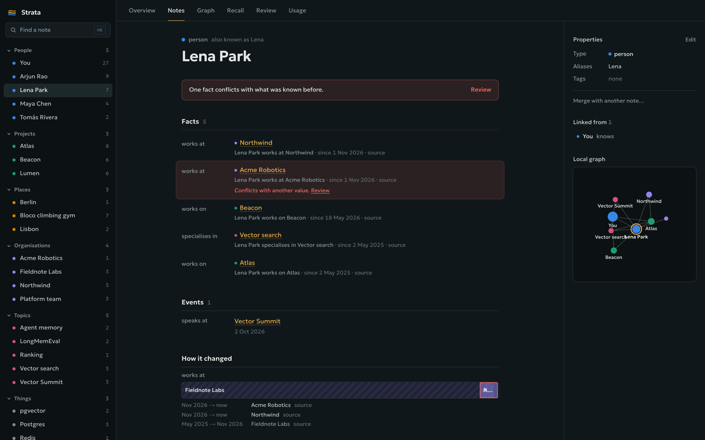
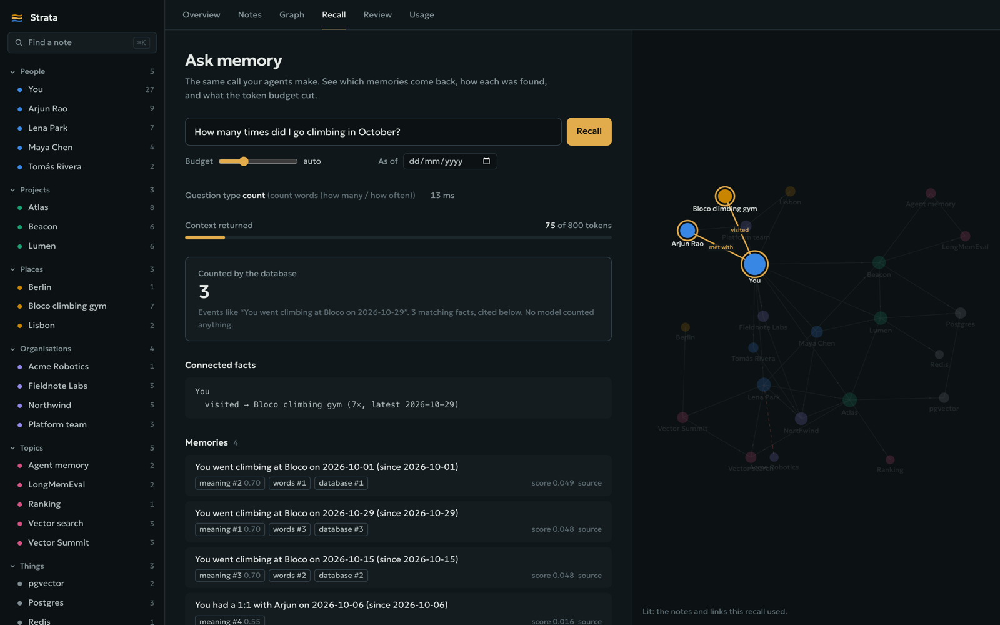
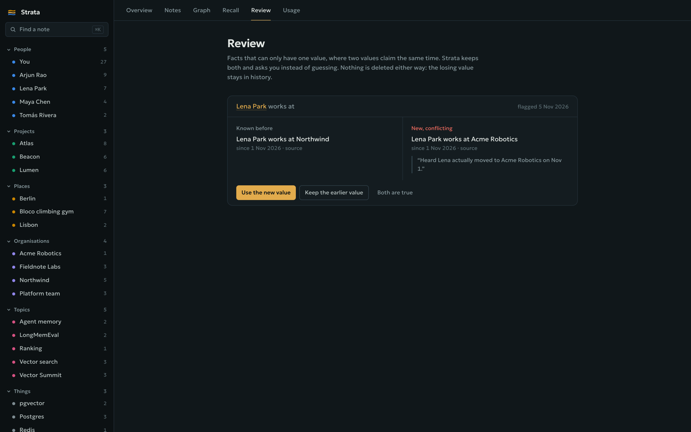
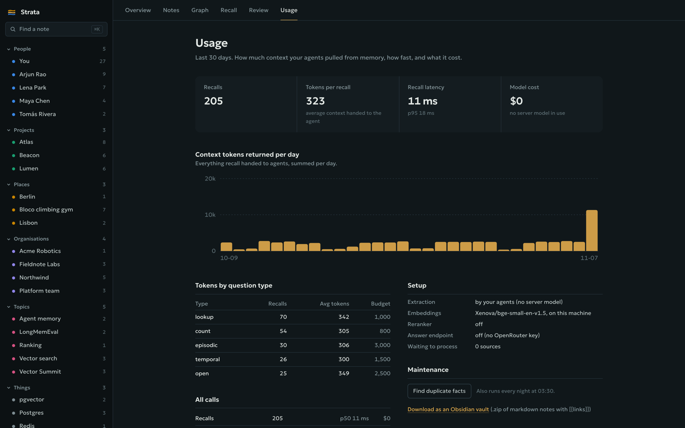

<div align="center">


# **Strata**

### **Memory for your AI agents that can count, cite, and show its work.**

One memory shared by every agent you run. Your agent decides what's worth keeping and sends it as
facts; Strata keeps them current over time, links them into notes like an Obsidian vault, and answers
"how many" and "when did I last" with SQL instead of a guess.

<br />

[](https://www.typescriptlang.org/)
[](https://nodejs.org/)
[](https://hono.dev/)
[](https://github.com/pgvector/pgvector)
[](https://nextjs.org/)
[](#-development)
[](LICENSE)

**Works with**

[](#-connect-your-coding-agent)
[](#-connect-your-coding-agent)
[](#-connect-your-coding-agent)
[](#-connect-your-coding-agent)
[](#-your-own-code)
[](#-what-you-get)

**Runs on**

[](#-quick-start)
[](https://huggingface.co/BAAI/bge-small-en-v1.5)
[](https://openrouter.ai/)

[Why Strata](#-why-strata) ·
[How it works](#-how-it-works) ·
[Screens](#-what-you-get) ·
[Quick start](#-quick-start) ·
[Connect your agent](#-connect-your-coding-agent) ·
[Configuration](#-configuration) ·
[Architecture](#-architecture)

<br />



</div>

---

## ✨ Why Strata

Most agent memory is a vector store with a chat log on top. It forgets what changed, can't count,
and can't tell you why it returned what it did. Strata is built around those three gaps:

| | Question | How Strata answers it |
|---|---|---|
| 🕰️ | **What's true *now*, and what was true then?** | Every fact has `valid_from` / `valid_to`. A new job closes the old one instead of deleting it, so "where did Maya work in March?" still works. |
| 🔢 | **How many times? When did I last?** | Counts and latest dates go to Postgres, not to a model reading snippets. The answer is exact and comes with the rows it counted. |
| 🔍 | **Why did my agent get *this* context?** | `explain: true` shows how each memory was found (meaning, words, a link, or SQL) and what the token budget cut. |
| ⚠️ | **What if two sources disagree?** | Both values are kept and flagged for review. Strata asks; it doesn't guess. |
| 🧠 | **Does it need its own LLM?** | No. Your agent already understands the conversation, so it sends structured facts. Strata runs no model by default. |

## 🧭 How it works



1. **Your agent extracts.** It calls `remember` with facts like
   `{ subject: "user", predicate: "lives_in", object: "Pune", exclusive: true }`. The original message is
   stored too, so nothing is lost.
2. **Strata files it.** Names are matched to existing notes (exact, alias, then fuzzy), so "Bioceutica"
   and "Bioceutica Milano" land on the same note. An `exclusive` fact closes the previous value.
3. **Everything gets indexed.** Facts and raw text are embedded on your machine and indexed for full-text
   search. Each fact becomes a link between two notes.
4. **A question is routed first.** "How many times…" and "when did I last…" go straight to SQL. "Where
   did I live on 2026-03-01?" reads the facts valid on that date.
5. **Everything else is a hybrid search.** Meaning, words and graph links are fused (RRF), the facts
   around the people and projects you named are pulled in, and the result is trimmed to your token budget.
6. **You can see all of it.** The web app shows every note, link and fact, the history of each one,
   and exactly what any recall returned.

## 🖥️ What you get

<table>
<tr>
<td width="50%" valign="top">

**Overview**: what your agents know, how it grew, and anything that needs a decision.



</td>
<td width="50%" valign="top">

**Graph**: the whole memory as linked notes, coloured by type.



</td>
</tr>
<tr>
<td valign="top">

**Time travel**: drag the slider to see the graph as it was on any day.



</td>
<td valign="top">

**Notes**: one per person, project or place, with properties, backlinks and a local graph.



</td>
</tr>
<tr>
<td valign="top">

**History and conflicts**: replaced facts stay visible; clashing ones are flagged.



</td>
<td valign="top">

**Recall inspector**: a count answered by SQL, with the rows it counted.



</td>
</tr>
<tr>
<td valign="top">

**Review**: accept, reject or keep both when facts conflict.



</td>
<td valign="top">

**Usage**: recalls, tokens returned and latency over time.



</td>
</tr>
</table>

Plus a <kbd>⌘</kbd> <kbd>K</kbd> quick switcher, live updates as agents write, and **export to an
Obsidian vault** (one Markdown file per note, with `[[links]]`).

## 🚀 Quick start

**You need:**  Node 22+,
 [pnpm](https://pnpm.io) and
 [Postgres.app](https://postgresapp.com)
(pgvector included). No API keys.

```bash
git clone https://github.com/Divyanshu832/strata.git
cd strata
createdb strata
cp .env.example .env          # set STRATA_ADMIN_TOKEN to any long random string
pnpm install
pnpm migrate
```

**1. Create an API key** for your workspace and put it in `.env` as `STRATA_API_KEY`:

```bash
pnpm --filter @stratamem/server create-key "me"
```

**2. API** (Hono on port 8787)

```bash
pnpm dev
```

**3. Web app** (Next.js on port 3000)

```bash
pnpm dev:web
```

**4. Connect your coding agents** (Claude Code, Codex, Gemini CLI, Cursor)

```bash
pnpm connect
```

Open **http://localhost:3000**. It fills up as soon as your agents start remembering.

> [!TIP]
> The embedding model (~35 MB) downloads once on first use to `~/.cache/strata/models`. After that,
> Strata works fully offline.

## 🔌 Connect your coding agent

One command connects every coding agent on your machine. No prompts to paste, nothing to remember:

```bash
pnpm connect                 # every agent it finds
pnpm connect claude codex    # or pick: claude · codex · gemini · cursor
```

For each agent it sets up three things, and keeps everything else in your config as it was:

1. **The MCP tools** (`remember`, `recall`, `find_note`, `open_note`, `timeline`, `neighbours`, `forget`).
2. **Lifecycle hooks**, so memory works even when the model forgets to use it.
3. **A memory rule** in the agent's global instructions file.

| |  Claude Code |  Codex |  Gemini CLI |  Cursor |
|---|:---:|:---:|:---:|:---:|
| 🧰 MCP tools | ✅ | ✅ | ✅ | ✅ |
| 🧭 Memory brief when a session starts | ✅ | ✅ | ✅ | ✅ |
| 🔎 Recall on every message | ✅ | ✅ | ✅ | — ¹ |
| 💾 Conversation saved, searchable | ✅ | ✅ | ✅ | ✅ |
| ✍️ Save checkpoint every 6 messages and after compaction | ✅ | ✅ | ✅ | ✅ |
| 📜 Memory rule | `~/.claude/CLAUDE.md` | `~/.codex/AGENTS.md` | `~/.gemini/GEMINI.md` | in the brief ² |

<sub>¹ Cursor has no hook that can add context to a message. ² Cursor keeps user rules in its settings
screen, so the session-start brief carries the rule instead.</sub>

**What the hooks do**

| Moment | What happens |
|---|---|
| Session starts | Injects a **memory brief**: how to use Strata, who you are, this project, the latest memories. Starts the local API if it isn't running |
| You send a message | **Recalls** what Strata knows about it and adds it to the context |
| The agent stops | Saves the new part of the conversation as **searchable text** (keys and tokens redacted, tool output skipped) |
| Every 6 messages | **Checkpoint**: the agent has to save every decision and lasting fact with `remember` before it stops |
| Before compaction, at the end | Saves what's left, then runs a checkpoint |

> [!IMPORTANT]
> **Codex:** run `/hooks` once inside Codex to review and trust the Strata hooks; Codex skips untrusted
> hooks. **Gemini CLI:** if the hooks show as disabled, run `/hooks enable-all`. Restart any agent that
> was open while you connected.

Every file is backed up once (`*.strata-backup`) before its first change, and re-running is safe.
`pnpm connect --remove` undoes it; `pnpm connect --dry-run` shows what would change.

<details>
<summary><b>Tune it</b></summary>

The hooks read `STRATA_URL` and `STRATA_API_KEY` from the environment or the repo's `.env`.

| Variable | Default | What it does |
|---|---|---|
| `STRATA_CHECKPOINT_EVERY` | `6` | Messages between save checkpoints |
| `STRATA_HOOK_RECALL` | on | `0` turns off recall on every message |
| `STRATA_AUTOSTART` | on | `0` never starts the local API from a hook |

The hook is one plain-JavaScript file (`packages/mcp/hooks/strata-hook.mjs`), so it starts in about 60 ms
and never needs a build. If Strata is unreachable it steps aside and the session carries on.

</details>

### 🧩 Any other MCP client

Point it at the MCP server (stdio):

```bash
node packages/mcp/node_modules/tsx/dist/cli.mjs --env-file-if-exists=.env packages/mcp/src/index.ts
```

### 🛠️ Your own code

```ts
import { Strata } from "@stratamem/sdk";

const strata = new Strata({ apiKey: process.env.STRATA_API_KEY! });

// Your agent extracted this; Strata saves it as-is.
await strata.remember({
  content: "I moved to Pune in May.",
  facts: [{
    subject: "user", predicate: "lives_in", object: "Pune",
    exclusive: true, validFrom: "2026-05-01",
  }],
});

const memory = await strata.recall({ query: "Where do I live?", maxTokens: 1000, explain: true });
```

Or call the REST API directly: `POST /v1/memories`, `POST /v1/recall`.

> [!NOTE]
> Raw text with no agent behind it (imports, webhooks) is stored and searchable as-is. Set
> `EXTRACTOR=openrouter` and Strata's optional extractor turns it into facts in the background.

## ⚙️ Configuration

Everything lives in `.env` (gitignored). The defaults are local and free.

| Variable | Default | What it does |
|---|---|---|
| `DATABASE_URL` | `postgres://localhost:5432/strata` | Postgres with pgvector |
| `STRATA_ADMIN_TOKEN` | | Secret for admin routes (workspaces, API keys) |
| `STRATA_API_KEY` | | Key the MCP server and web app use |
| `EMBEDDING_MODEL` | `Xenova/bge-small-en-v1.5` | Runs inside the server; 384 dimensions |
| `RERANKER` | `none` | `local` adds a small cross-encoder, also on your machine |
| `EXTRACTOR` | `none` | `openrouter` extracts facts from raw text on the server |
| `OPENROUTER_API_KEY` | | Only for `EXTRACTOR=openrouter` and `POST /v1/answer` |

## 🏗️ Architecture

```
strata/
├── packages/
│   ├── server/              Hono API · Postgres · pgvector
│   │   ├── migrations/      SQL, run in order by `pnpm migrate`
│   │   └── src/
│   │       ├── routes/      memories · recall · notes · workspace · admin
│   │       └── services/
│   │           ├── write.ts       Save facts, replace old values, flag conflicts
│   │           ├── entities.ts    Match names to notes (exact → alias → fuzzy)
│   │           ├── router.ts      Count · latest · as-of · lookup
│   │           ├── structured.ts  The SQL answers
│   │           ├── search.ts      Vector, full-text and graph search
│   │           ├── rrf.ts         Fuse the rankings
│   │           ├── recall.ts      The read path, end to end
│   │           ├── budget.ts      Pack results into the token budget
│   │           └── embed.ts       In-process embeddings (transformers.js)
│   ├── mcp/                 MCP server (stdio) for Claude Code and other agents
│   ├── sdk/                 TypeScript client, @stratamem/sdk
│   └── web/                 Next.js 16 · React 19 · Tailwind v4: notes, graph, recall, review
└── bench/                   Python benchmark runner (LongMemEval-S, corrected LoCoMo)
```

**Workspaces** keep memories apart (for example work and personal): each API key belongs to one, and
Postgres row-level security enforces it.

## 📊 Benchmarks

`bench/run.py` runs **LongMemEval-S** and a **corrected LoCoMo** against Strata, no memory, full context
and Hindsight, with two answer models. It reports accuracy, tokens per answer, latency and **$ per correct
answer**. See the docstring at the top of the file.

## 🛠️ Development

```bash
pnpm typecheck
pnpm test        # 39 unit tests, plus end-to-end API tests when the database is reachable
```

## 🔒 Privacy and safety

- **Local by default.** Your memories, embeddings and search never leave your machine unless you turn
  on the optional extractor.
- **Nothing is silently lost.** Replaced facts are closed, not deleted. Only `forget` deletes, and every
  delete is written to an audit log with what was removed.
- **Separate workspaces**, one API key each, enforced in the database.
- **No secrets in memory.** The hooks redact keys and tokens before saving a conversation, skip tool
  output, and the memory rule tells agents never to save passwords, keys or tokens.

## 🗺️ Roadmap

- [x] Time-aware facts with history and conflict review
- [x] SQL answers for counts, latest dates and "as of" questions
- [x] Hybrid recall with explain traces and a token budget
- [x] MCP server, REST API and TypeScript SDK
- [x] Notes, graph with time slider, recall inspector, review, usage
- [x] Export to an Obsidian vault
- [ ] Published benchmark results (LongMemEval-S, corrected LoCoMo)
- [ ] Import existing memories, with an import page in the web app
- [ ] Light theme
- [ ] Faster bulk ingest (batched embeddings)

## 📄 License

Strata is source-available under the [PolyForm Noncommercial License 1.0.0](LICENSE).

- ✅ **Free** for personal projects, study, research, hobby use, and for charities, schools and public institutions.
- ✅ You can read, run, change and share it, as long as you keep the license with it.
- ❌ **No commercial use**: you can't sell it, offer it as a paid service, or use it in a commercial product.

Want to use Strata commercially? [Get in touch](https://github.com/Divyanshu832).

---

<div align="center">
<sub>Built by <a href="https://github.com/Divyanshu832">Divyanshu Shekhar</a>. Free for noncommercial use under the <a href="LICENSE">PolyForm Noncommercial License</a>.</sub>
</div>
